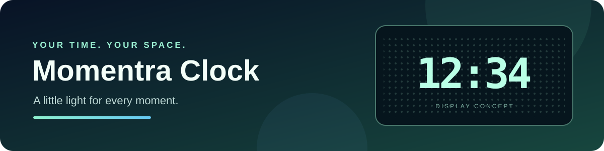
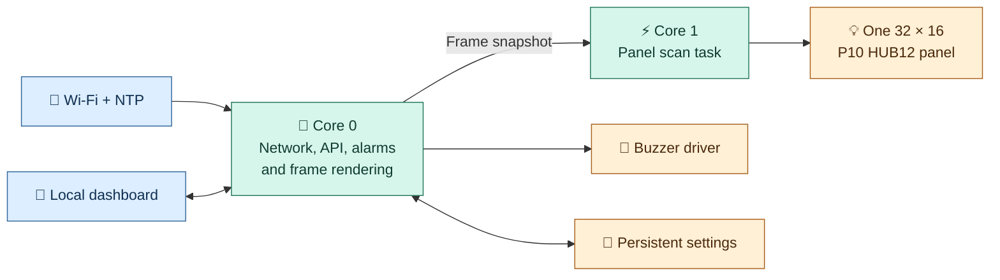

<div align="center">



# Momentra Clock

**A local-first clock for an ESP32 and a single monochrome P10 panel.**

**Firmware version 1.0.0**

🕒 NTP time &nbsp; • &nbsp; ⏰ Alarms &nbsp; • &nbsp; 🎨 Display styles &nbsp; • &nbsp; 📱 Local dashboard &nbsp; • &nbsp; 🔄 OTA

[🚀 Install](#get-started) · [✨ Features](#meet-momentra) · [🔌 Wiring](#hardware-wiring) · [📚 Documentation](#documentation) · [🛠️ Build](#build-flash)

</div>

> [!WARNING]
> **Use on a trusted, isolated network.** The setup AP, dashboard and API have no authentication or encryption. Factory flashing overwrites saved Wi-Fi credentials and settings. The latest display redesign has not been physically verified; do not use this clock as a safety-critical alarm.

<a id="meet-momentra"></a>
## ✨ Meet Momentra

| | Feature | What it brings |
| :---: | --- | --- |
| 🕒 | **Time** | NTP synchronization, regional timezones, optional two-line display and connection status |
| ⏰ | **Alarms** | Five persistent one-shot or daily alarms and adjustable ringing durations |
| 🔔 | **Sound** | Hourly chimes, four buzzer rhythms and optional button feedback |
| 🎨 | **Display** | Brightness, 12 selectable font styles, blinking colon and seconds animations |
| ⏱️ | **Timers** | Stopwatch and a pauseable countdown reminder |
| 📱 | **Control** | Local browser dashboard, themes and a JSON HTTP API |
| 🔄 | **Updates** | Browser-based application OTA with rollback support |

### 🧩 What you need

- **Controller:** original ESP32 or ESP32-S3 with at least 4 MB flash.
- **Display:** **one** 32 × 16 monochrome P10 panel with HUB12 and 1/4 scan.
- **Color:** white, red, green, blue, yellow or pink fixed-color panels may work when their interface, polarity and scan order match the driver.
- **Optional sound:** an active buzzer with a suitable external driver.
- **Not supported:** RGB/multicolor panels or multiple chained panels.
- **Compatibility:** individual panel models and colors have not been verified. Check the [hardware guide](docs/hardware.md) before connecting anything.

<a id="get-started"></a>
## 🚀 Get started

### 1️⃣ Download the flasher

### [⬇️ Open GitHub Releases](https://github.com/sgsudhir/Momentra-Clock/releases)

- Choose the **Windows x86-64 ZIP** or **Ubuntu x86-64 tar.gz**, extract it and run the launcher.
- Keep the launcher window open and follow its local page in **Chrome or Edge**.
- The launcher, page and included firmware work offline after download.
- Portable packages are available **only after a release is published**; a build does not establish hardware compatibility.
- The flasher also supports custom ESP binaries and offsets, with separate data-loss warnings.

### 2️⃣ Check, connect and install

1. Read the [wiring and power guide](docs/hardware.md) and check your board and panel.
2. Connect the ESP32 using a **USB data cable** and select its serial port in the flasher.
3. Choose the Momentra preset, review the warning and flash the image for the detected chip.
4. Wait for verification; release BOOT and press **EN / RESET** once to start normally.
5. Connect to the open **`Momentra Clock`** Wi-Fi network and visit **[192.168.4.1](http://192.168.4.1/)** to configure Wi-Fi.

> [!CAUTION]
> The Momentra factory image **overwrites saved settings and Wi-Fi credentials even without whole-chip erase**. Back up first. The S3 image uses a separate DevKitC-1 N16R8 mapping: flash readback was verified on an S3, but its panel and wiring remain untested.

📖 [Step-by-step installation](docs/installation.md#first-installation-with-the-portable-flasher) &nbsp; | &nbsp; 🛠️ [Modify, build and upload](docs/installation.md#modify-build-and-upload)

<a id="documentation"></a>
## 📚 Explore the documentation

| Guide | Your next stop |
| --- | --- |
| 🗺️ [Wiki home](docs/README.md) | Guided paths and documentation index |
| 🚀 [Installation and deployment](docs/installation.md) | First flash, provisioning, security and release checklist |
| 🔌 [Hardware and pinout](docs/hardware.md) | Boards, panel signals, power and 2N2222 buzzer circuit |
| 📱 [Dashboard](docs/dashboard.md) | Illustrated controls and everyday use |
| 🔗 [HTTP API](docs/api.md) | Endpoints, parameters, examples, errors and status |
| 🧠 [Architecture and flows](docs/architecture.md) | Startup, cores, tasks, data flow and synchronization |
| 💻 [Developer reference](docs/development.md) | Modules, functions, persistence, tests and maintenance |
| 🧰 [Operations and troubleshooting](docs/operations.md) | Recovery, OTA and hardware verification |

> [!NOTE]
> The wiki describes the current source, not a guarantee of regulatory, safety, accessibility or production certification.

<a id="hardware-wiring"></a>
## 🔌 Hardware & wiring

### 📍 Factory GPIO map

| Signal | Original ESP32 | ESP32-S3 DevKitC-1 N16R8 |
| --- | ---: | ---: |
| HUB12 DATA | GPIO 23 | GPIO 4 |
| HUB12 CLK | GPIO 18 | GPIO 5 |
| HUB12 LATCH / STB | GPIO 19 | GPIO 6 |
| HUB12 OE | GPIO 21 | GPIO 7 |
| HUB12 A | GPIO 22 | GPIO 15 |
| HUB12 B | GPIO 25 | GPIO 16 |
| Active buzzer **driver input** | GPIO 26 | GPIO 17 |

- These are **chip GPIO numbers**, not physical module or HUB12 pin numbers. Other boards and revisions may use different header positions.
- The S3 mapping is an example for the **DevKitC-1 N16R8** and has not been panel-tested. Verify the actual board and avoid its USB, flash, PSRAM and board-peripheral pins.
- Default GPIOs are in [`sdkconfig.defaults`](sdkconfig.defaults) and [`sdkconfig.defaults.esp32s3`](sdkconfig.defaults.esp32s3). Update existing configurations through **P10 clock hardware** in menuconfig.
- The project defaults enable the panel; existing configurations may need to enable it explicitly.
- Buzzer control is active-high on startup. Set its GPIO to `-1` if unwired or used for another purpose. An alarm is not claimed or disabled when the buzzer GPIO is unconfigured.
- Firmware rejects unsafe or duplicate panel/buzzer GPIOs. Also check the module's actual reserved pins and strapping requirements.

### ⚡ Before you power up

> [!IMPORTANT]
> Check the panel's marked signals, connector orientation, 1/4 scan pattern and DATA/OE polarity. Do not assume a ribbon-cable orientation.

- Use appropriately rated panel and ESP32 supplies, a common ground and suitable level shifting. **Never power the panel from GPIOs.**
- For a 5 V panel, use suitable 3.3-to-5 V logic buffers, such as correctly powered AHCT-family buffers. Keep OE inactive during reset.
- Use a suitable transistor and supply for the buzzer. For a 5 V active buzzer, provide a low-side driver with a gate/base pull-down and protection for an inductive load.
- Verify actual panel and buzzer ratings before selecting components. Begin at low brightness with appropriate current limits.
- The configured panel scan uses SPI mode 0, 4 MHz, MSB first, four interleaved rows, binary A/B addressing, active-low DATA and active-high OE.
- Opposite OE polarity can be selected in menuconfig; existing configurations must be updated. Different shift order may require driver changes.
- The [DMD2 scan conventions](https://github.com/freetronics/DMD2/blob/08a1d8ed06f5005a5a88f6f7d0f4d423d4db4f07/DMD2.cpp) informed this experimental ESP-IDF driver; DMD2 is not included and compatibility is not guaranteed.
- The [white-panel product page](https://robu.in/product/p10-outdoor-white-led-display-panel-module/) was inaccessible directly; a search listing described a 512-LED panel. Connector orientation and DATA polarity were not independently verified; the user reported active-high OE. Confirm details with the panel or manufacturer.
- GPIO selection also references the [ESP32-WROOM-32 datasheet](https://documentation.espressif.com/esp32-wroom-32_datasheet_en.pdf).

➡️ **Circuit diagrams, resistor calculations, board headers and power details:** [Hardware guide](docs/hardware.md)

## 🧠 How it fits together



- The scan task is pinned to **core 1** and wakes from a 1 ms hardware timer. A core 0 render task supplies frames, which the scan task snapshots at a row-group boundary.
- Alarm, HTTP and network application tasks and the TCP/IP task are pinned to **core 0**.
- Other ESP-IDF tasks and interrupts can still affect core 1. The timer schedules wakeups, but row updates remain scheduler-dependent; flash operations can affect refresh.
- OTA explicitly blanks the display while writing. See [architecture and flows](docs/architecture.md) for details.

<a id="build-flash"></a>
## 🛠️ Build & flash

- Select **ESP32** or **ESP32-S3** in the ESP-IDF VS Code extension and build for the matching target.
- The default configuration uses 4 MB flash, an OTA partition table, rollback, a 1 kHz FreeRTOS tick and core 0 TCP/IP affinity. Existing configurations may need updating in menuconfig.
- Both factory images use a **4 MB layout**, even on larger flash, with two 1.875 MiB OTA application slots.
- The first flash must include the bootloader, partition table and application. Check the panel wiring before flashing a panel-enabled build.
- Partition changes can overwrite or make existing data inaccessible. Back up first; use a deliberate full-flash/migration procedure, not OTA across an incompatible layout.

➡️ [Full build and upload instructions](docs/installation.md#modify-build-and-upload)

## 📡 Wi-Fi, security & time

### 🔐 Network setup

1. On first boot or after five failed connection attempts, connect to the open **`Momentra Clock`** setup AP.
2. Visit **[192.168.4.1](http://192.168.4.1/)** and enter station credentials. Older firmware uses `P10-Clock-Setup` until updated.
3. The clock saves candidate credentials and reboots. Successful credentials replace the previous ones; failed connections return to the setup AP and retry periodically.
4. Find the station IP on the serial console, or use [momentra.local](http://momentra.local/) where mDNS works. Use the IP if mDNS is unavailable or hostnames collide.

- DHCP supplies the station IP and DNS servers.
- The setup screen can scan broadcast SSIDs and show RSSI; use the hidden-network option for an unadvertised SSID. Scans may briefly interrupt traffic or fail while connecting.
- **Security:** the open AP can expose submitted credentials; anyone on the station network can change settings, reboot or upload firmware. OTA is rejected unless connected in station-only mode. Do not expose the device to an untrusted LAN or the public Internet.

### ⏰ Time & connection screens

| Stage | Panel behavior |
| --- | --- |
| Connecting | `WiFi` appears, including in setup AP mode until a station connection succeeds |
| Connected | RSSI for 2 seconds, then the last IP octet for 2 seconds |
| Awaiting time | Two-line `SYNC` and five dots |
| Synchronized | Clock display; running timers can temporarily take display priority |

- Time source: `pool.ntp.org`. Select a named primary timezone; the default is **Asia/Kolkata**.
- The optional second timezone appears on the second panel row; the primary time is on the first. Both use 24-hour time and a fixed 5×7 font, without seconds animation.
- The saved single-zone time format, font and animation return when two-line mode is disabled.
- Alarms and hourly chimes use the primary timezone. Both timezone selections and the second-line switch survive restarts.
- Timezone rules are bundled from **IANA tzdb 2026f**, including aliases, for 1970–2100. Rules may change politically; install updated firmware with refreshed tzdb when needed. Outside this range timezone offsets are unavailable and scheduled sounds are suppressed.
- The device requests a new sync every minute after successful responses; network failures can delay retries.
- Brief Wi-Fi outages do not immediately invalidate time. After **12 hours** without a successful sync, connected devices show `SYNC` and suppress scheduled alarms and chimes.

## 🎛️ Controls, alarms & timers

### 🎨 Make it yours

- Set brightness from **0–100%**, choose among **12 selectable styles**, and select 12/24-hour display. The panel does not show AM/PM.
- The original sizes include 14-pixel large, 12-pixel medium and 5×7 small; additional options include tall, extra small, wide, two bold variants, digital segments and rounded compact.
- Removed styles 3–5 keep their saved IDs for API compatibility but render as Style 1; the page selects Style 1 for those values. Before downgrading, select Style 1 or 2.
- Optional colon blinking and dot, minute-progress, bouncing-ball and jumping-ball animations use synchronized time. Both effects default off and persist across restarts.
- Animations use the bottom four rows, are disabled for taller fonts and are hidden on timer or connection screens. Stopwatch and reminder displays use a separate compact 4×7 font.
- Dashboard themes: Light, Dark, Ocean, Sunset, Lavender, Sand, Forest and Midnight. Theme selection is stored in the browser; browser animation respects reduced-motion settings.

### 🔔 Alarms & sound

- **Five slots:** one-shot or daily; durations of 5, 10, 15, 20, 30, 45, 60, 90, 120, 150, 180, 240 or 300 seconds. Older saved durations remain supported.
- **Persistence:** one-shot alarms are persisted as disabled before sounding. Stop an active alarm from the page or API.
- **Priority:** simultaneous alarms sound for the longest requested duration; alarms take priority over hourly chimes and reminder sound. Reboot stops ongoing sound.
- **Hourly rhythms:** one long, two medium, three short, or two short followed by one long beep. Alarms repeat four rapid beeps and a pause; reminders use the previous slower on/off alarm pattern. An active buzzer changes rhythm, not pitch.
- **Feedback:** successful settings, alarm and Wi-Fi saves and stopwatch actions request a 100 ms beep after existing sounds. The saved button-feedback setting also controls stopwatch-limit feedback, not alarms, reminders or chimes.
- **Scheduling:** only the current minute is considered; missed alarms are not replayed. A backward clock correction suppresses repeated minutes until time exceeds the last processed minute.
- **Restart caveat:** daily alarms can sound again after reboot in the same scheduled minute. One-shot alarms remain disabled once claimed; power loss between disabling and sounding can skip one. Storage failures are logged and can leave persisted state uncertain.

### ⏱️ Stopwatch & reminder

| | Stopwatch | Reminder |
| --- | --- | --- |
| Range | Up to **99:59.99** | **1 second–24 hours** |
| Controls | Start, pause, resume, reset | Start, pause, resume, stop |
| Sound | Start, pause/resume and stop | Requires a configured buzzer; rings up to 15 seconds unless stopped |
| Panel | `ST`, MM:SS:tenths | `RE`, HH:MM:SS |

- Both use monotonic time, do not need NTP and are cleared on reboot.
- The panel prioritizes a running stopwatch, then a running or ringing reminder, then the clock. Paused timers remain visible in the dashboard.

### 📊 Dashboard status

- Status refreshes approximately every **5 seconds**, so alarm/reminder changes can take that long plus network latency; short sounds can finish between polls.
- The browser interpolates the clock and alarm countdown locally and re-anchors to device time about every **15 seconds**. Scheduling and network latency affect accuracy.
- Expandable sections show enabled alarms, next occurrences and system details; the stop control appears at the top when an alarm is reported ringing.
- System details include local IP and station MAC. The API also exposes a stable factory-MAC-derived chip identifier to anyone with access.

## 🔗 REST API

- Responses are JSON. Configuration requests use `application/x-www-form-urlencoded`; all fields listed below are required unless noted.
- Successful writes return `{"ok":true}`. Invalid input returns **400**, concurrent changes **409**, and operational errors **500** with an `error` field.
- Full reference: [HTTP API documentation](docs/api.md).

| Method & endpoint | Purpose |
| --- | --- |
| `GET /api/status` | Read system, network, time, display, alarm and timer state |
| `POST /api/settings` | Change brightness, font, time format, primary timezone, sound and animations |
| `GET /api/timezones` / `POST /api/timezones` | List named timezones / configure the second timezone |
| `POST /api/alarm` | Configure an alarm slot |
| `POST /api/alarm/stop` | Stop the current alarm sound |
| `POST /api/timer` | Start, pause, resume or stop a stopwatch or reminder |
| `POST /api/wifi/scan` / `GET /api/wifi/scan` | Start a scan / read its state and networks |
| `POST /api/wifi` | Save candidate station credentials and reboot |
| `POST /api/reboot` | Reboot |
| `POST /api/ota` | Upload a raw application image and reboot into the inactive slot |

<details>
<summary><strong>📋 API fields and constraints</strong></summary>

- **Status:** `firmware_version`, `uptime_seconds`, `free_heap_bytes`, `min_free_heap_bytes`, `wifi_connected`, `setup_ap`, `wifi_rssi`, `local_ip`, `wifi_mac`, `chip_id`, `time_valid`, `unix_time`, `unix_time_ms`, `sync_age_seconds`, `display_ready`, `buzzer_configured`, `ringing`, `ringing_mask`, `stopwatch_state`, `stopwatch_ms`, `reminder_state`, `reminder_ms`, `brightness`, `font`, `format_12h`, `hourly_enabled`, `hourly_pattern`, `feedback_enabled`, `colon_blink`, `seconds_animation`, `timezone_primary`, `timezone_secondary`, `timezone_secondary_enabled`, their current `_offset` values, `alarms` and `alarm_next_seconds`.
  - RSSI and IP are null when unavailable; Unix time is null when unsynchronized; sync age is null if never synchronized. Credentials are never returned.
- **Settings:** `brightness` 0–100, `font` 0–14, `format_12h` 0/1, `hourly_enabled` 0/1 and `hourly_pattern` 0–3. Optional `feedback_enabled` and `colon_blink` are 0/1; optional `seconds_animation` is 0 off, 1 dot, 2 progress, 3 bounce or 4 jump. Optional `timezone_primary` is an IANA name from `/api/timezones`. Omitted optional fields retain their values.
- **Second timezone:** `POST /api/timezones` requires `timezone_secondary` and `timezone_secondary_enabled` (0/1).
- **Alarm:** `index` 0–4, `enabled` 0/1, `hour` 0–23, `minute` 0–59, `repeat` 0 once or 1 daily, and `duration_seconds`.
- **Timer:** `timer` is `stopwatch` or `reminder`; `action` is `start`, `pause`, `resume` or `stop`. Starting a reminder also requires `seconds` 1–86400. Stop resets the timer and dismisses a ringing reminder. Status states: 0 stopped, 1 running, 2 paused, 3 ringing.
- **Wi-Fi scan:** returns state and, when complete, networks with `ssid_hex` (UTF-8 SSID bytes in hexadecimal) and `rssi` in dBm. Hidden SSIDs are omitted; non-UTF-8 names are not selectable in the UI.
- **Wi-Fi save:** `ssid` is 1–32 bytes; `password` is empty for an open network or 8–63 bytes.
- **OTA:** upload a raw application `.bin` for the matching target, not a bootloader or combined flash image. A successful upload selects the inactive slot and reboots. Local initialization confirms the new image; failure before confirmation permits bootloader rollback.

</details>

<details>
<summary><strong>💻 Example requests</strong></summary>

Replace the address with your clock's IP:

```sh
curl http://192.168.1.50/api/status
curl -X POST -d 'brightness=50&font=0&format_12h=0&hourly_enabled=1&hourly_pattern=0&feedback_enabled=1' http://192.168.1.50/api/settings
curl -X POST -d 'index=0&enabled=1&hour=7&minute=30&repeat=1&duration_seconds=30' http://192.168.1.50/api/alarm
curl -X POST http://192.168.1.50/api/alarm/stop
curl -X POST --data-binary @firmware.bin http://192.168.1.50/api/ota
```

</details>

## 🧪 Host checks

<details>
<summary><strong>Run the host-side checks</strong></summary>

```sh
cc -std=c11 -Wall -Wextra -Werror -I main \
  main/clock_config.c main/clock_timezone.c main/clock_schedule.c main/clock_freshness.c \
  main/clock_render.c main/clock_scan.c main/clock_form.c main/clock_sound.c tests/test_clock_logic.c \
  -o /tmp/esp-p10-clock-logic-test
/tmp/esp-p10-clock-logic-test
cc -std=c11 -Wall -Wextra -Werror -pthread -I tests/stubs -I main \
  main/clock_config.c main/clock_timezone.c main/clock_store.c tests/test_clock_store.c \
  -o /tmp/esp-p10-clock-store-test
/tmp/esp-p10-clock-store-test
cc -std=c11 -Wall -Wextra -Werror -I main \
  main/clock_config.c main/clock_timezone.c main/clock_status.c tests/test_clock_status.c \
  -o /tmp/esp-p10-clock-status-test
/tmp/esp-p10-clock-status-test | node tests/test_status_json.js
cc -std=c11 -Wall -Wextra -Werror -I main \
  main/clock_timer_logic.c tests/test_clock_timers.c -o /tmp/esp-p10-clock-timers-test
/tmp/esp-p10-clock-timers-test
cc -std=c11 -Wall -Wextra -Werror -I main \
  main/clock_config.c main/clock_timezone.c main/clock_schedule.c tests/test_clock_timezone.c \
  -o /tmp/esp-p10-clock-timezone-test
/tmp/esp-p10-clock-timezone-test
node tests/test_dashboard.mjs
```

</details>

> [!WARNING]
> Hardware testing is still needed for signal mapping, brightness and flicker under Wi-Fi/flash load, AP provisioning and reconnects, NTP, buzzer timing, persistence, OTA failure recovery and rollback.

---

<div align="center">

**Made for the moments that matter.** ✨

[Back to top ↑](#momentra-clock)

</div>
