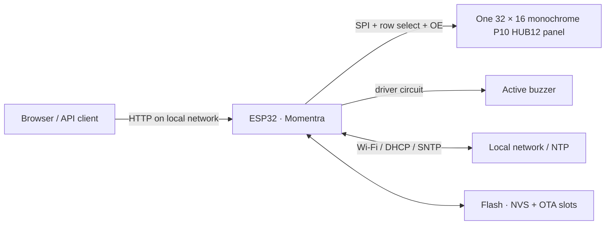

# Momentra Clock documentation

> One small panel. A clock, alarms, timers and a local dashboard.

[Project README](../README.md) · [Install](installation.md) · [Hardware](hardware.md) ·
[Dashboard](dashboard.md) · [API](api.md) · [Architecture](architecture.md) ·
[Development](development.md) · [Troubleshooting](operations.md)

## Choose your path

| I want to… | Read |
| --- | --- |
| Assemble and deploy a device | [Installation and deployment](installation.md) |
| Choose a board, wire the panel and build the buzzer driver | [Hardware and pinout](hardware.md) |
| Configure the clock from a phone or computer | [Dashboard guide](dashboard.md) |
| Integrate another local application | [HTTP API reference](api.md) |
| Understand tasks, cores and data flow | [Architecture and flows](architecture.md) |
| Change, test or extend firmware | [Developer reference](development.md) |
| Diagnose a fault or update safely | [Operations and troubleshooting](operations.md) |

## What Momentra does

- Displays local time using an NTP-synchronized ESP32 and **one** 32 × 16,
  1/4-scan monochrome P10 HUB12 panel. White, red, green, blue, yellow and
  pink are possible fixed LED colors on matching single-color variants; each
  panel model needs verification. RGB and multiple panels are not supported.
  Select a primary IANA timezone and, optionally, display a second timezone.
  Asia/Kolkata is the default.
- Serves a local dashboard for display settings, five alarms, a stopwatch,
  one reminder, Wi-Fi setup, restart and firmware upload.
- Saves display settings and alarms in NVS; timers are volatile. A buzzer
  produces selectable hourly rhythms and alarm, reminder and feedback sounds.
- Exposes a small HTTP API without a cloud account or an external server.
  NTP and package installation still require network access.

## Important boundaries

> [!WARNING]
> The open setup AP and HTTP endpoints have no authentication or encryption.
> Nearby users can observe credentials sent through setup, and LAN clients can
> control or reflash the device. Use only a trusted, isolated network. This
> firmware is not a security-hardened production appliance.

The latest firmware changes have passed the previously run host checks and
build, but the latest panel redesign has not been uploaded or verified on
physical hardware. Electrical compatibility, actual refresh quality, OTA
recovery and power-loss behavior must be tested on the intended device.
Diagrams are explanatory examples, not verified manufacturing designs or
screenshots.

## Reading conventions

- **GPIO** means the ESP32 chip GPIO number, not a connector pin position.
- **Local time** follows the selected primary timezone (Asia/Kolkata by default). API Unix timestamps are UTC epoch values.
- **Persistent** means stored in NVS and intended to survive restart;
  **volatile** means lost on restart.
- API examples use `192.168.1.50` as a placeholder, not a fixed device address.
- Commands are for a trusted workstation with ESP-IDF activated; use the
  project directory as the working directory.

Documentation follows clear units, explicit error and safety notes, and
relative links. It does not assert compliance with any particular international
standard; regulatory and accessibility conformance require separate assessment.
