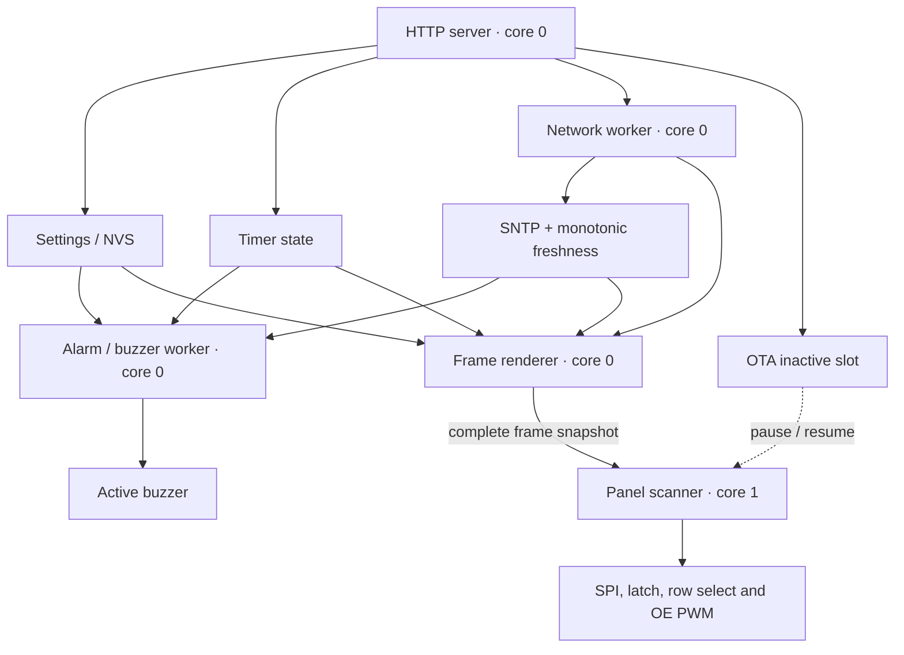
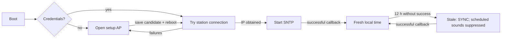

# Architecture and control flows

[Wiki home](README.md) · [Installation](installation.md) ·
[API](api.md) · [Developer reference](development.md)

## System overview

## Startup

[`app_main`](../main/main.c) initializes NVS, settings storage, display,
alarm/buzzer, network and HTTP in that order. Initialization errors go through
`ESP_ERROR_CHECK`. After those initializations succeed, a running OTA image in
pending-verification state is marked valid. This is a local startup check, not
a test of Internet connectivity, panel readability or buzzer acoustics.

Network initialization configures timezone and SNTP but starts SNTP after the
station obtains an IP. With no saved credentials the device enables the open
setup AP. On each successful station connection the panel normally shows
RSSI for two seconds, then the last IPv4 octet for two seconds, followed by
time or `SYNC` and five dots. While disconnected it shows `WiFi`. A running
stopwatch or running/ringing reminder takes display priority and can hide
these screens.

## Tasks and core affinity

These are application-created workers, not an exhaustive ESP-IDF task list.
Priorities are FreeRTOS priorities; stack sizes below are the byte counts passed
to ESP-IDF task creation. Actual intervals are subject to scheduling and load.

| Task | Core | Priority | Stack | Behavior |
| --- | ---: | ---: | ---: | --- |
| `clock_display` | 1 | 8 | 4096 B | Shifts one row group, updates latch/row/OE and delays 1 ms; while paused, acknowledges and delays 10 ms. |
| `clock_render` | 0 | 5 | 4096 B | Builds a complete frame; delays 10 ms for a running stopwatch, otherwise 100 ms. |
| `clock_alarm` | 0 | 5 | 4096 B | Updates timers, schedules and buzzer; delays 25 ms during a scheduled alarm, otherwise 50 ms. |
| `clock_network` | 0 | 5 | 4096 B | Consumes Wi-Fi events; a 30 s queue timeout permits reconnect attempts. |
| HTTP server | 0 | ESP-IDF default | 8192 B | Serves the dashboard and request handlers. |
| `wifi_scan` | 0 | 4 | 6144 B | Temporary worker for a blocking scan. |
| `restart` | 0 | 5 | 2048 B | Temporary worker delays 1 s before restart. |

`CONFIG_LWIP_TCPIP_TASK_AFFINITY_CPU0` is set in project defaults. Core 1 is
**not exclusively reserved**: interrupts, ESP-IDF system tasks and
flash/cache operations can affect scanning. A 1 ms delay per row is not a
guaranteed refresh period or flicker-free performance. Measure the actual
panel under network and flash load.

## Frame production and scanning

The renderer and scanner target one 32 × 16 monochrome P10 HUB12 panel with
1/4 scan. LED color is fixed by the panel; see
[display requirements](hardware.md#display-requirements) for supported
single-color variants and hardware limitations.

1. The renderer snapshots settings, timers and network/time state.
2. Display priority is running stopwatch, running or ringing reminder,
   connection sequence, then synchronized clock or sync screen.
3. It publishes the entire 32 × 16 bitmap and brightness under a short
   critical section.
4. The scanner copies the published frame only at row-group zero, keeping
   it for the complete four-address scan.
5. Each group is encoded as 16 SPI bytes, shifted at 4 MHz in mode 0,
   blanked, latched and addressed. LEDC drives OE at 20 kHz with 8-bit duty.

This boundary avoids mixing parts of two rendered frames; it does not prevent
all timing jitter. DATA polarity and OE polarity are build configuration
choices. The selected panel mapping must be verified on the actual module.

## Wi-Fi and time

The event callback places messages in a bounded queue; the network task
performs connection and storage work. A candidate credential set is stored as
pending, then promoted on connection. The previously saved set is not
overwritten until promotion. The device retries after failures; the setup AP
is enabled after five failed connection attempts.

[`clock_time.c`](../main/clock_time.c) sets `TZ=IST-5:30`, initializes
`pool.ntp.org` and requests 60-second synchronization intervals. Successful
callbacks record monotonic time. Freshness is valid only for elapsed time
strictly below 12 hours; an invalid or backward monotonic reference is stale.
Wall time and freshness serve different purposes: wall time is used for
display/schedules, monotonic time for freshness, stopwatch and reminder.
Short Wi-Fi interruptions do not immediately invalidate an earlier sync.

## Alarms, timers and sound

The schedule processes each new absolute local minute once and examines only
the current minute. Missed minutes are not replayed; backward corrections are
suppressed until the clock advances beyond the last processed minute. A
restart resets this deduplication state. A one-shot alarm is persisted as
disabled before sounding; a power failure in between can skip it. Daily
alarms can trigger again if the device reboots during the same minute.

The alarm worker is the sole buzzer owner. Scheduled alarms take precedence
over an active hourly chime; scheduled sound takes precedence over a reminder,
which takes precedence over feedback. Simultaneous alarms use the longest
claimed duration. A stop request stops the current scheduled alarm/chime;
stopping a reminder is a separate timer action. The stopwatch and reminder
are monotonic and are cleared on reboot.

## Concurrency and persistence

- A mutex protects the in-memory settings snapshot; a separate write mutex
  serializes NVS writes and compare-and-save updates. Readers do not wait
  for flash I/O while holding the state mutex.
- Short critical sections protect published frames, network snapshots,
  timer state and buzzer requests. Wi-Fi events use a queue.
- Settings are published after successful NVS commit. Concurrent HTTP updates
  may return `409`; fetch current state and retry deliberately.
- OTA pauses and blanks scanning before writing the inactive slot. On failure
  the handler attempts to resume it. A successful upload selects the slot and
  schedules reboot; rollback depends on bootloader configuration and successful
  early startup of the new image. See [OTA operations](operations.md#firmware-update-and-recovery).

Snapshots from different subsystems are collected separately; a status
response is useful telemetry, not a globally atomic transaction.
